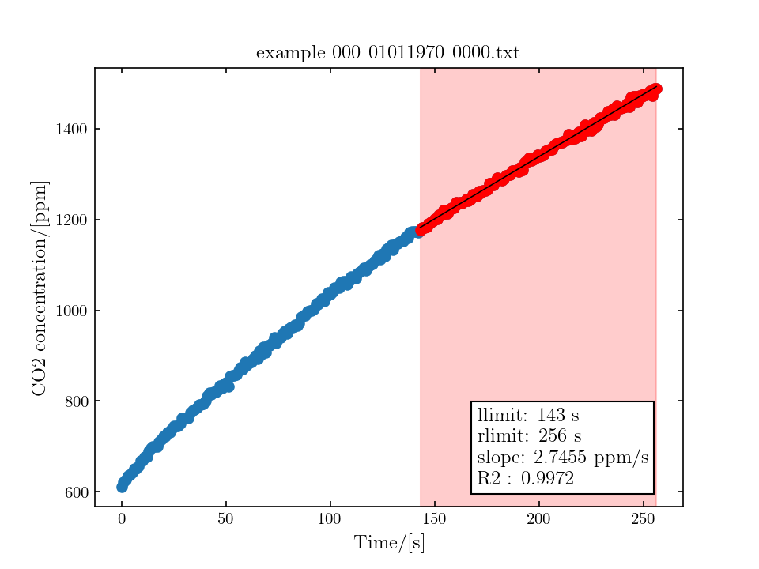

# westsystems_ac

Utilities for the processing of data files produced by WestSystems accumulation chambers software (FluxManager: https://www.westsystems.com/instruments/download/).  These utilities provide functionality similar to FluxRevision, and allow for molar fluxes (i.e. units of mol/m2/day) to be calculated from the slope of concentration as a function of time plots.

## Provided classes/functions and usage

### WestsystemsFile

Main class.  Reads and processes the raw data from gas concentration measurements at a site.

```python
from westsystems_ac import WestsystemsFile # or ...westsystems_ac.westsystems...

wsf = WestsystemsFile('example_000_01011970_0000.txt',
		       gas_species='CO2', 
		       ac_chamber='B')
```

The WestsystemsFile class will parse the data file "example_000_01011970_0000.txt" and display a plot of the concentration data for the chosen gas species a function of time.  The user can then select the portion of the data that he wishes using clicks of the left mouse button.  An initial erroneous click can be undone using the right mouse button.  After the region is selected, it is shown in red on the plot (see example below) and the user is invited to validate ('y') the data or reselect the region ('n') by typing a response in the console.  This process will continue until 'y' has been entered.  An image of the the validated data plot will then be saved in the same directory as the data file.  

Simultaneously, a pandas.DataFrame is created (one entry) as a class attribute.  The fitting parameters can be accessed through various ```wsf.fit``` attributes.



### calc_ack

```python
calc_ack(p, T, ac_chamber='B')
```
Returns the coefficient of proportionality to convert rate of change of concentration to molar flux.  Tested to match values provided in the WestSystems user guide.  Called by the WestsystemsFile._calc_ack() method.  

### batch_run

```python
df = batch_run(path, gas_species='CO2', ac_chamber='B', outfile='database.csv')
```
Allows for fluxes to be calculated for the collection of files under ```path```, using ```glob```.  


## Batch processing 

The following code will batch process all files in the directory DIR_NAME, treating CO2 data for accumulation chamber type B

```bash
python read_westsystems.py DIR_NAME -s CO2 -c B
```

To run from the current directory, use "./" as DIR_NAME.  As of v0.0.2, several optional arguements can be parsed:
```bash
-s (or --species) : gas species, default "CO2"
-c (or --chamber) : AC chamber type, default "B"
-o (or --output)  : name of the output file, default "output.csv"
```

This "main programme" functionality uses the ```batch_run``` function.  

## Requirements

This packaged depends on, and has been tested using the following pagages/machine configuration:
```bash
numpy      : 1.26.4
scipy      : 1.16.0
matplotlib : 3.10.5
utm        : 0.7.0
pandas     : 2.2.0
sklearn    : 1.5.2

Python implementation : CPython
Python version        : 3.12.3
IPython version       : 9.6.0

Compiler     : GCC 13.3.0
OS           : Linux
Release      : 6.8.0-90-generic
Machine      : x86_64
Processor    : x86_64
CPU cores    : 16
Architecture : 64bit
```

Additionally, ```batch_run``` and the main programme use the inbuilt packages ```sys```, ```os``` and ```glob```.

## TO DO:
- read all metadata, including sensor data
- Ensure propper working for H2S
